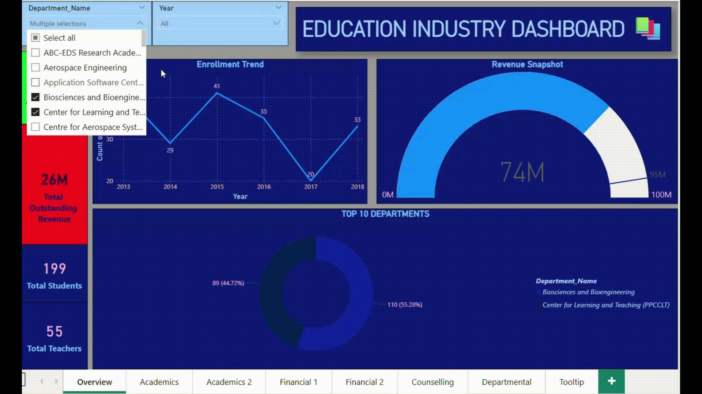
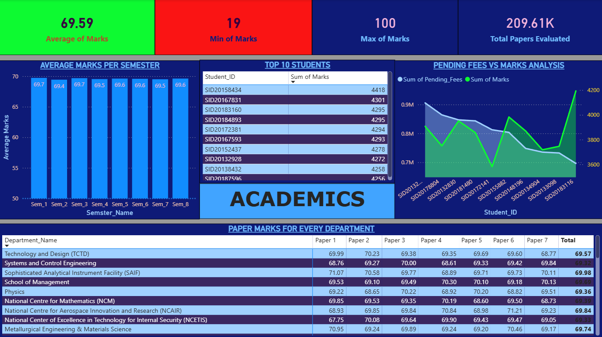
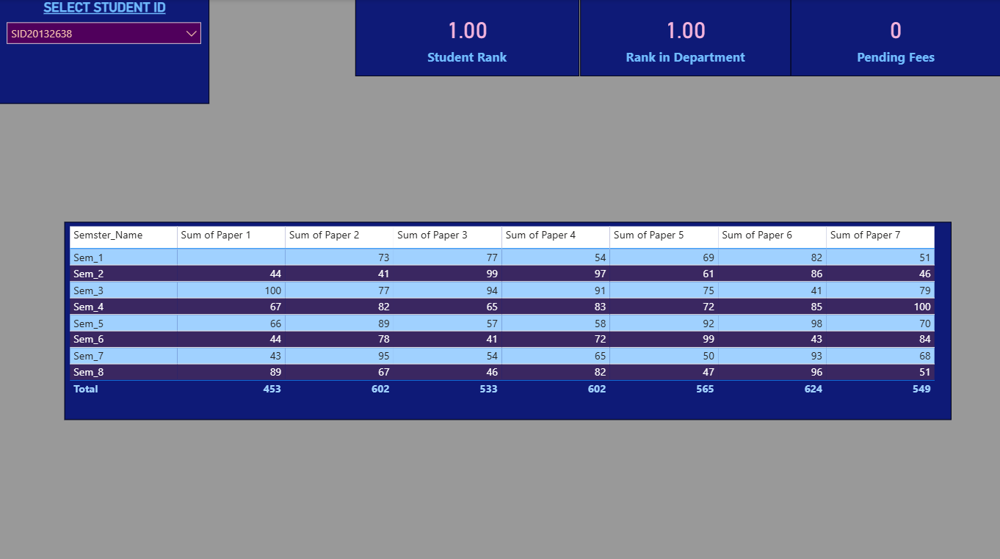
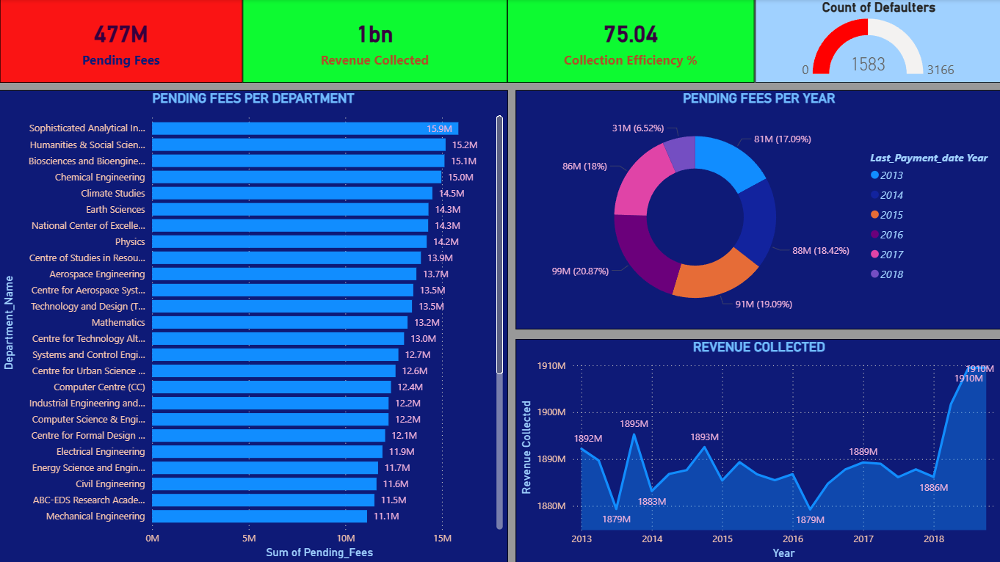
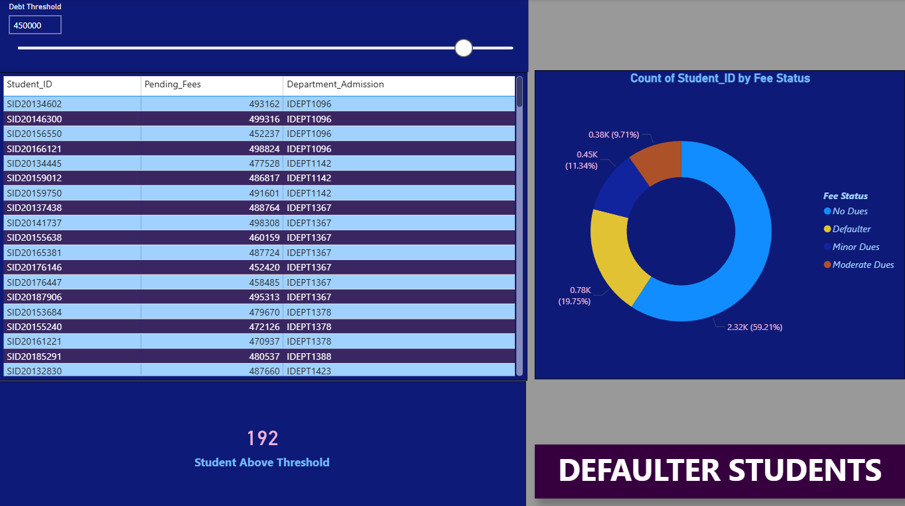
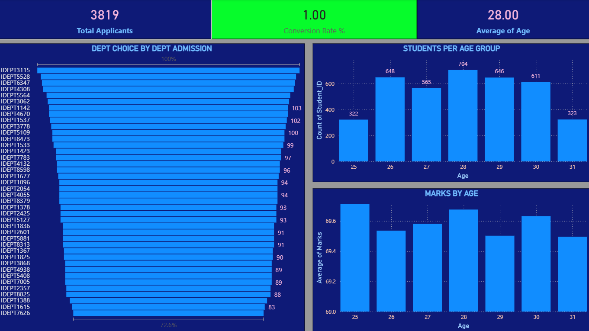
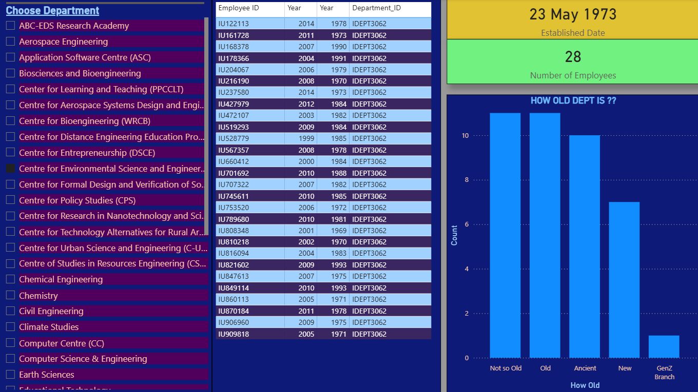

# Education Industry Dashboard | Power BI

An interactive **Education Industry Dashboard** built in Microsoft Power BI to explore academic performance, student admissions, departmental information, counselling, and financial outcomes in one report.

> **Project preview:** The animated GIF and screenshots below show the report's pages and visual design. Open the `.pbix` file in Power BI Desktop to explore the interactive report.

## Dashboard Demo



## Dashboard Pages

### 1. Academics — Performance Overview

Explore student marks and academic performance through KPI cards, semester-level averages, top-student rankings, pending-fee comparisons, and department-wise paper marks.



### 2. Academics — Student Detail

A student-focused view with a Student ID selector, rank indicators, pending-fee information, and paper marks across semesters.



### 3. Financial Overview

Review fee collection and outstanding balances with department-wise pending-fee comparisons, year-wise breakdowns, and revenue trends.



### 4. Financial Analysis

A supplementary financial view for examining fee-related patterns and supporting deeper analysis of collections and outstanding amounts.



### 5. Counselling & Admissions

Explore applicant and admission patterns, department choices, age-group distributions, and marks by age.



### 6. Departmental Analysis

Filter departments and review department information, employee records, establishment date, employee count, and department-age categories.



### 7. Tooltip / Visual Detail

Example of the report's tooltip-oriented visual design.


## Key Features

- **KPI cards** for quick summaries of academic and financial metrics.
- **Interactive slicers and filters** to explore selected students, departments, and other report dimensions.
- **Academic performance analysis** by semester, paper, student, and department.
- **Student ranking views** to compare overall and department-level performance.
- **Fee analysis** covering pending fees, fee status, collection efficiency, and revenue trends.
- **Admissions analysis** with department-choice and age-group visuals.
- **Departmental insights** including employee and department-age summaries.
- **Consistent report styling** using a dark-blue theme, contrasting chart colours, and labelled visuals.

## Tools

- Microsoft Power BI Desktop
- Power Query for data preparation (where used in the report)
- DAX measures and calculated logic (where used in the report)

## Repository Structure

```text
Education-Industry-Dashboard/
├── README.md
├── Education Industry Dashboard.pbix
└── assets/
    ├── academics-overview.png
    ├── student-academics-detail.png
    ├── financial-overview.png
    ├── financial-analysis.png
    ├── counselling-dashboard.png
    ├── departmental-dashboard.png
    ├── tooltip-example.png
    └── dashboard-demo.gif
```

## How to View the Project

1. Download or clone this repository.
2. Open `Education Industry Dashboard.pbix` in **Microsoft Power BI Desktop**.
3. If Power BI asks for source files or credentials, update the data-source settings to match your local setup.
4. Use the report tabs, slicers, and visual interactions to explore the dashboard.

## Notes

- The screenshots and GIF are included so the project can be previewed directly on GitHub without opening Power BI.
- GitHub renders the animated GIF automatically; it is a GIF preview rather than a hosted video player.
- If the report uses a local data source that is not included in the repository, the visuals may require reconnecting or refreshing the data.
- Verify that you have permission to share the underlying data before publishing the `.pbix` file publicly.

## Author

**Your Name**  
Add your LinkedIn, portfolio, or contact details here.

---

If you find this project useful, feel free to ⭐ the repository.
